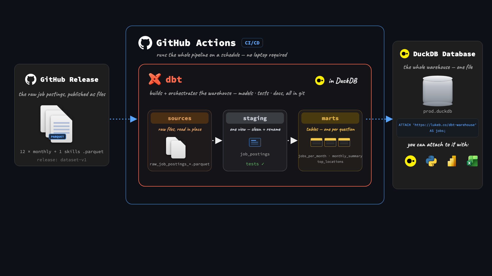
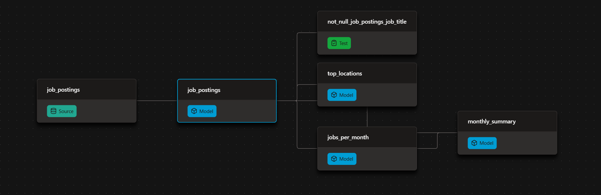

# Automated Job Postings Pipeline (v1) - dbt + DuckDB

[](https://github.com/Brandon-m-Y/DE_Projects_W_DBT/actions/workflows/dbt_build.yml)



A public dbt + duckdb pipeline with over ~692k real job postings, rebuilt and republished automatically on every push via GitHub Actions.

- Models the raw postings into tested, documented insights marts
- Publishes the docs site and the finished warehouse open to anyone, no credentials needed
- Runs itself on GH Actions: every push and every Monday

> **v1 of this pipeline**: everything is free and runs locally. DuckDB is the warehouse and GitHub Actions is the scheduler.

| What I Built | How I Implemented | Where to Look |
| --- | --- | --- |
| **dbt pipeline** | raw source → cleaned view → 3 insight marts | [`analytics/models/`](analytics/models/) |
| **Data tests** | `not_null` on `job_title`; a failing test fails the build | [`schema.yml`](analytics/models/schema.yml) |
| **Documentation** | model + column descriptions, written into the warehouse with `persist_docs` | [`schema.yml`](analytics/models/schema.yml) |
| **Public CI** | build + test + publish on every push | [Actions workflow](https://github.com/Brandon-m-Y/DE_Projects_W_DBT/actions/workflows/dbt_build.yml) |
| **Environments** | local `dev` vs CI `prod` targets | [`ci/profiles.yml`](ci/profiles.yml) |
| **Published warehouse** | one `ATTACH`, queryable by anyone | [Query it](#-query-the-published-warehouse) |

---

## ⚙ The dbt Pipeline

Raw parquet postings flow through two dbt layers: a declared source feeds a cleaned view, which feeds the insight marts. Tests run on every build. The DAG below is the whole flow:



| Model | Materialization | Grain | What it answers |
| --- | --- | --- | --- |
| [`job_postings`](analytics/models/job_postings.sql) | view | one row per scraped posting | Cleaned postings, failed scrapes (`error IS NOT NULL`) removed |
| [`jobs_per_month`](analytics/models/jobs_per_month.sql) | table | month × role | How many postings each role gets per month |
| [`top_locations`](analytics/models/top_locations.sql) | table | location (top 10) | Where the most postings are |
| [`monthly_summary`](analytics/models/monthly_summary.sql) | table | month | Total postings, remote postings, and % remote per month |

The dbt features doing the work:

| dbt Feature | How I Used It |
| --- | --- |
| Declared sources (no hardcoded paths in SQL) | [`sources.yml`](analytics/models/sources.yml) + `source('raw', 'job_postings')` |
| Model dependencies | `ref()` everywhere downstream; dbt works out build order and parallelism |
| Materializations | project default `table`; `job_postings` overrides to `view` |
| Data tests | `not_null` on `job_title` in [`schema.yml`](analytics/models/schema.yml) |
| Persisted docs | `persist_docs` writes descriptions into DuckDB as table and column comments |
| Environments | local `dev` vs CI `prod` targets ([`ci/profiles.yml`](ci/profiles.yml)) |

`dbt build` compiles the SQL, materializes the models, and fails the run if any test fails. The same command runs locally and in CI.

---

## 🚀 Production

GitHub Actions runs the whole pipeline, so no laptop is needed: [`.github/workflows/dbt_build.yml`](.github/workflows/dbt_build.yml)

| Trigger | What happens |
| --- | --- |
| Push to `master` | Full rebuild |
| Weekly (Monday, 06:17 UTC) | Scheduled rebuild that keeps the warehouse fresh |
| Manual (`workflow_dispatch`) | Run button in the Actions UI |

On each run, Actions:

1. Installs dependencies with `uv`
2. Downloads the raw parquet files
3. Runs `dbt build` with the committed CI profile (`prod`)
4. Publishes `prod.duckdb` as a GitHub Release asset

The badge at the top of this README links to the latest runs.

---

## 🦆 Query the published warehouse

You don't need to clone anything. [Install DuckDB](https://duckdb.org/docs/installation/), then run this in a `duckdb` session:

```sql
INSTALL httpfs;
LOAD httpfs;

ATTACH 'https://github.com/Brandon-m-Y/DE_Projects_W_DBT/releases/download/warehouse/prod.duckdb' AS jobs;
USE jobs;
SHOW TABLES;

SELECT * FROM top_locations;
SELECT * FROM monthly_summary;
SELECT * FROM jobs_per_month;
```

> Query the three mart tables. `job_postings` is a view over the raw parquet files, so it only resolves in a local build that has `data/raw/`.

---

## 📖 Docs

Every model and column has a description in [`schema.yml`](analytics/models/schema.yml). To browse the lineage graph, descriptions, and tests locally:

```bash
cd analytics
uv run dbt docs generate
uv run dbt docs serve
```

The site shows:

- The full **lineage graph** (source → view → marts)
- **Model and column descriptions** from the YAML
- Which columns carry **tests**

---

## 💻 Run it yourself

```bash
uv sync
uv run python scripts/download_data.py
cd analytics && uv run dbt build
```

Local runs use a `dev` target in `~/.dbt/profiles.yml`:

```yaml
analytics:
  target: dev
  outputs:
    dev:
      type: duckdb
      path: ../data/dev.duckdb
      threads: 4
```

To build the `prod` warehouse the same way CI does, run `uv run dbt build --profiles-dir ../ci` from `analytics/`.

---

## 📁 Project layout

```text
.
├── .github/workflows/dbt_build.yml   # public CI: build, test, publish
├── ci/profiles.yml                   # prod DuckDB target for Actions
├── data/                             # raw parquet + warehouses (gitignored; CI regenerates)
├── img/                              # README diagrams
├── analytics/
│   ├── dbt_project.yml
│   └── models/                       # sources.yml, schema.yml, 4 models
├── scripts/download_data.py          # fetches raw parquet before the build
└── pyproject.toml                    # uv-managed dependencies
```

---

*Built as Project #1 of Luke Barousse's [dbt for Data Analytics & Engineering course](https://www.lukebarousse.com) ([reference build](https://github.com/lukebarousse/dbt_Analytics_Engineering_Course/tree/main/project_1)). Dataset: real job postings scraped daily.*
